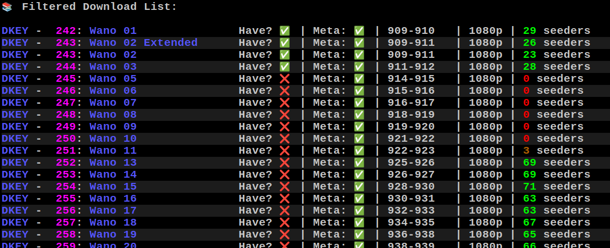
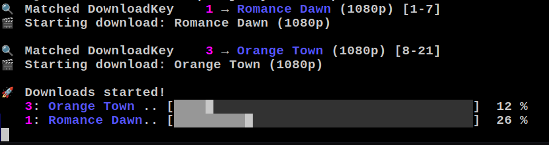
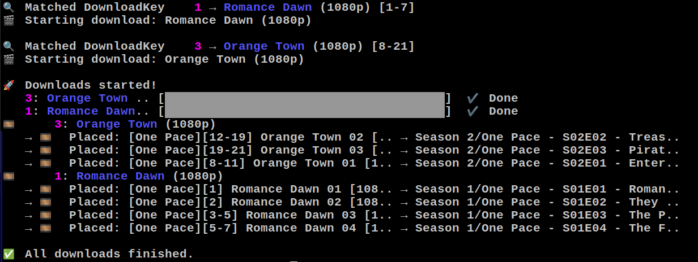

# 🏴‍☠️ OpforJellyfin


CLI-tool to automate download and organisation of [One Pace](https://onepace.net) episodes for **Jellyfin**!

> ✨ Torrent downloads  
> ✨ Placement after Jellyfin standards  
> ✨ Metadata from [Barry’s One Pace set](https://github.com/tissla/opfor-metadata-barrys)

---

# 📢 NEWS 

## Opfor 1.2.0 release!

New update finally!
1. New metadata source repo (Barrys metadata)
2. The 'sort'-command is here! 
3. The 'download all' command is here for testing.
4. Download progress bars being glitchy are fixed, and graphics updated.

And more!
Don't hesitate to post issues as you find them.

## Sort existing downloads

```bash
./opfor sort "/path/to/downloads"
./opfor sort "/path/to/episode.mkv"
```

Moves matched videos into their arc folders in the configured library, preserving filenames. Directories are searched recursively. Unmatched files and destination conflicts remain at their source paths. Known filename aliases receive matching NFO and thumbnail copies.

Failed torrent placements remain under the library's `.opfor-tmp` directory and can be retried with `sort`. `clear` deletes temporary downloads, including those unplaced files.

## 📸 Examples

1. Example command:

   ```bash
   ./opfor list -t wano
   ```

   

2. Downloading episodes:

   ```bash
   ./opfor download 1 3
   ```

   

3. Finished download shows file placement:

   

4. Keep track of what you have:

   ```bash
   ./opfor info
   ```

   

5. And much more!

## 🔧 Installation

You can choose to either use one of the released versions or build from source yourself.

For this program to work, you need to have 'git' installed.

### [Releases](https://github.com/tissla/opforjellyfin/releases/tag/v1.2.0)

MacOS / Linux:

1. Download the file for your system.

2. Run `chmod +x opfor` to make the file runnable.

3. Run with `./opfor --help` to get started.

Windows:

1. Download the .exe file.

2. Run the file in Powershell or Windows Terminal with `.\opfor.exe --help` to get started.

A terminal that supports unicode-characters is heavily recommended for best experience.

### Build from source

1. **Install Go** (version ≥ 1.23)

2. Clone repo:

   ```bash
   git clone https://github.com/tissla/opforjellyfin.git
   cd opforjellyfin
   ```

3. Build binary:

   ```bash
   go build -o opfor
   ```

## 🚀 Usage (Start Here!)

1. Set your download directory before doing anything else. All your metadata will be stored here, and downloads will be matched to their proper folders.

   ```bash
   ./opfor setDir "/media/One Piece/One Pace"
   ```

   Episode thumbnails are disabled by default. Posters and backdrops are always downloaded.

   ```bash
   ./opfor setDir "/media/One Piece/One Pace" --thumbnails
   ./opfor setDir "/media/One Piece/One Pace" --thumbnails=false 
   ```

   The choice is saved and reused by `sync`. Omitting the flag keeps the saved choice. Disabling thumbnails skips `*-thumb.png` and `*-thumb.jpg` during Git fetching; existing local images are kept.


1. Find all available episodes with 'list', or use the -t flag to specify a title, or -r flag to specify a chapter-range.

   ```bash
   ./opfor list
   ./opfor list -t Wano
   ./opfor list -r 15-20
   ```

1. Download a torrent by using the downloadkey, displayed in front of the title. You can download one or multiple at the same time.

   ```bash
   ./opfor download 15 16 17
   ```

1. Download all missing episodes automatically, with up to five torrents running at once.

   ```bash
   ./opfor download all
   ./opfor download all --include-extended --include-specials
   ```

   `all` fetches a fresh torrent list and chooses the most seeded source at **1080p or higher** for each missing episode matched by Barry's index. Resolution is checked per video filename, including inside batches; lower or unknown resolutions are skipped without fallback. Existing episodes are skipped, including inside arc batches. Extended versions and specials are optional; each flag can be used separately. Only missing, allowed video files are selected from batches. `--seed` cannot be combined with `all` because seeding would block the queue.

   A total progress bar shows completed and remaining episodes for the selected downloads. An episode counts as complete after successful placement; failed downloads or placements remain in the remaining count. Elapsed time is shown during downloading, followed by a short file count and duration summary. Placement errors are still printed; successful placements are recorded with `--debug` instead of listed at the end.

   Downloads time out after 30 minutes without progress. Larger batches can keep downloading for longer as long as they make progress. `info` counts all indexed versions and resolutions, so its totals can exceed what `download all` selects.

## 📦 Metadata

Metadata and the generated `metadata-index.json` are downloaded from [opfor-metadata-barrys](https://github.com/tissla/opfor-metadata-barrys). Run `sync` before using the new placement flow. The program reads the index directly; it does not build metadata locally.

The 'sync' command allows the user to stay up to date with new additions to the metadata-repo.

### Steps to make sure Jellyfin doesn't mess with the metadata

1. Create a library with no metadata-fetchers active just for One Pace. Disable all of them!

1. Make sure the show is **unlocked** for changes.

1. Run `./opfor sync` again if Jellyfin messed up your .nfo files before this.

1. Rescan library with **unlocked** metadata and _no fetchers active_.

## 🤝 Contributions

All is welcome!

## ❤️ Acknowledgements

- Barry for their One Pace metadata set
- Anacrolix awesome torrent lib
- Charm team for cool stuff that I should use more
- One Pace team for their amazing work!

## ⚠️ Disclaimer

This tool is provided **as-is** with no guarantees or warranties.  
Use it at your own risk.

While care has been taken to avoid destructive behavior, this tool manipulates files and downloads torrents – always review the source code and test cautiously.  
The author is not responsible for any damage to your system, loss of data, or violation of terms of service related to the use of this software.

Also note:  
This project is not affiliated with One Pace, Jellyfin, or any content providers. Please respect local laws and copyright regulations.
